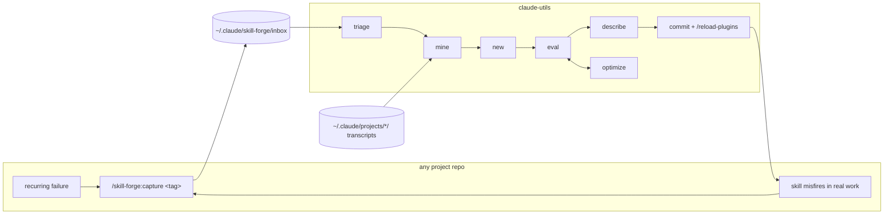
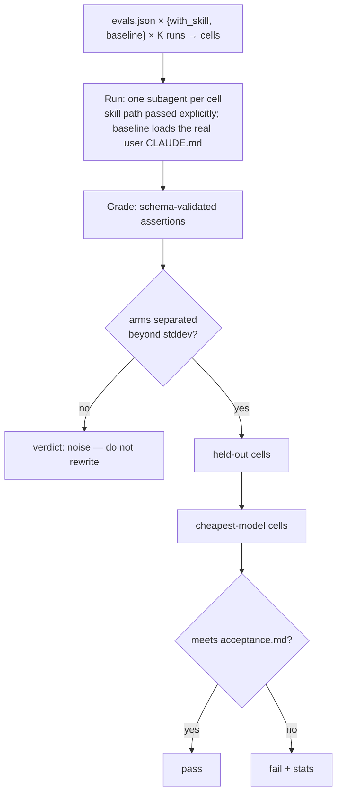
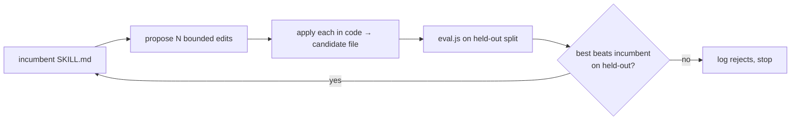

# skill-forge

Author skills for this marketplace from evidence of problems that keep recurring
in *other* projects, and measure them before shipping.

> **Status: implemented, untested in anger.** Every component below exists;
> none has been run end-to-end on a real skill yet. Workflows have been
> exercised against a mock runtime only.

## Why

Skills are cheap to write and hard to verify. The two papers vendored under
[`docs/`](docs/README.md) put numbers on the failure modes: a skill that reads
well is not more likely to work (an LLM judge picks the better-performing of two
skills 46.4% of the time — below chance), one in four skill/target pairs makes
the agent *worse*, and reorganizing a skill's structure has no measurable effect.
What predicts utility is concrete failure mechanisms with executable fixes.
`skill-forge` exists to get those mechanisms out of your own session history and
to make "does it help?" a measurement instead of an impression.

## Two locations

The problem happens in some project repo. The authoring, evaluation, and
shipping happen here in `claude-utils`. The plugin is installed at **user
scope** so its capture command exists everywhere; everything else refuses to run
outside this checkout because it writes into the repo and edits the marketplace
manifest.

Evidence never depends on where you are: Claude Code keeps transcripts under
`~/.claude/projects/<project>/`, keyed by project path, so a miner running from
`claude-utils` reads any project's history directly.



`capture` is the hinge. Before a skill exists it accumulates the evidence that
justifies writing one; after the skill ships, the same command feeds real-world
failures back into its eval set. It costs nothing until you type it.

## Commands

| Where | Command | Does |
| --- | --- | --- |
| any repo | `/skill-forge:capture <tag>` | Append `{tag, project, captured_at, note, prompt, what_went_wrong, what_fixed_it}` to the inbox |
| claude-utils | `/skill-forge:triage` | Cluster the inbox by tag: *"svelte-stores: 4 captures, 2 projects"* |
| claude-utils | `/skill-forge:mine <tag>` | Workflow: read the referenced transcripts, sweep those projects for the same pattern, write `evals/<name>/evidence.md`, seed prompts from your real phrasings, and draft `acceptance.md` |
| claude-utils | `/skill-forge:new <name>` | Scaffold `plugins/<name>/skills/<name>/SKILL.md`, `evals/<name>/`, and the marketplace entry; run the `skill-creator` interview seeded with the evidence |
| claude-utils | `/skill-forge:eval <name>` | The harness (below) |
| claude-utils | `/skill-forge:optimize <name>` | Gated edit loop (below); only for skills with mechanical assertions |
| claude-utils | `/skill-forge:describe <name>` | Wrap `skill-creator`'s `run_loop.py` to optimize the frontmatter description against held-out trigger queries |

One skill, `authoring`, holds the SkillLens rubric and this repo's conventions.
It loads whenever a `SKILL.md` is being drafted, with or without the commands.

## The eval harness

Everything the papers say to do — repeated runs, a realistic baseline, a
held-out split, a weaker-target check, gating on arithmetic rather than
judgment — becomes a loop parameter once the harness is a workflow.



- **K ≥ 3 runs per arm.** One run of a stochastic agent on three prompts is a
  coin flip. `skill-creator`'s `aggregate_benchmark.py` already supports
  `run-1/`, `run-2/`… layouts; the harness uses them.
- **Baseline against real context.** A skill can beat an empty context and add
  nothing on top of what the user-scope `CLAUDE.md` already says. If the delta
  vanishes, the right fix is a line in `CLAUDE.md`, not a skill.
- **Gate in code.** "Did the arms separate?" and "did held-out move?" are
  arithmetic in the workflow script, not a model's opinion.
- **Cache-busting.** Workflow resume replays any agent call whose prompt is
  unchanged. Every run prompt carries the skill's content hash so an edited
  skill never gets stale cached results.
- **Timing is not captured.** The workflow API doesn't return per-agent token
  usage, so `timing.json` is absent. The skill body's static size
  (`scripts/token-count.py`) is the cost figure that matters — it is paid on
  every trigger.
- **Two numbers multiply.** The harness measures Δ *given the skill was loaded*.
  Real value is P(trigger) × Δ, which is why `describe` is a multiplier, not a
  polish step.

## Optimize: a small SkillOpt

For skills whose assertions are fully mechanical, `optimize` runs the
propose-and-gate loop from the SkillOpt paper at small scale.



Analysts read the last iteration's transcripts under SkillOpt's prompt
contracts (Appendix C.2 of the paper): failure analysts — one per candidate,
each with a different lens — and one success analyst propose `append` /
`insert_after` / `replace` / `delete` edits; a merge step is failure-first,
ranks, and clips to the edit budget (default 4). Edits are applied in code,
candidates are scored on held-out by `eval.js` as a child workflow, and ties
are rejects. Rejected edits and their score deltas go to
`evals/<name>/rejected.json`, which the next round's analysts are shown.

Cost is roughly N candidates × held-out evals × K runs per round, so this is a
mode you choose, not the default. With subjective skills there is no gate and
the loop is just automated drift — `optimize` refuses to run without checked
assertions, a set target, and at least two held-out evals.

## Acceptance criteria

`mine` drafts `evals/<name>/acceptance.md`; you approve it line by line.

- **Assertions** — one per observed failure mechanism, each citing the capture
  or transcript it came from. Uncited assertions are flagged: an assertion
  nobody observed failing is the model inventing a plausible criterion.
- **Token budget** — derived from observed trigger frequency; the skill body is
  a context tax paid on every trigger, including false ones.
- **Pass-rate target** — left blank. It is set by you *after* the first
  baseline run and before iteration starts; `eval` refuses to iterate on an
  unset target. Pre-registration means not moving goalposts mid-loop, not
  guessing blind.

## What stays human

Deciding a problem deserves a skill. Approving assertions — everything
downstream optimizes against them, so a gameable assertion gets gamed at
machine speed. Setting the target. Reading the outputs, because the papers'
clearest finding is that the numbers can lie and the judge can be wrong.

## Layout

```
plugins/skill-forge/
├── README.md              this page
├── docs/                  vendored papers, licenses, citations
├── commands/              capture · triage · mine · new · eval · optimize · describe
├── skills/authoring/      SKILL.md + references/ (SkillLens rubric, acceptance template,
│                          evidence format, evals schema)
├── workflows/             mine.js · eval.js · optimize.js
└── scripts/               capture.sh · triage.py · skill-hash.sh · token-count.py · common.sh
```

A skill it produces lives in two places, following the repo's existing split:

```
plugins/<name>/skills/<name>/SKILL.md        the shipped skill
evals/<name>/
├── evidence.md                              failure mechanisms mined from transcripts
├── acceptance.md                            criteria, approved by you
├── evals.json                               prompts + assertions (committed)
├── fixtures/                                inputs or minimal fixture repos (committed)
└── workspace/                               run artifacts (gitignored)
```

Cases that can only reproduce in a real project carry `{repo, ref}` in
`evals.json` and run in a git worktree at that ref — machine-specific, marked as
such.

## Reuse, not reimplementation

`skill-forge` orchestrates `skill-creator` rather than replacing it: the
interview, `evals.json` schema, grader, `aggregate_benchmark.py`, the eval
viewer, and `run_loop.py` are used by path. `plugin-dev:plugin-validator` runs
before ship. SkillOpt itself is the graduation path for a skill whose scorer is
deterministic — the STE plugin is the first candidate, since
`evals/ste/tools/ste_lint.py` scores for free.
